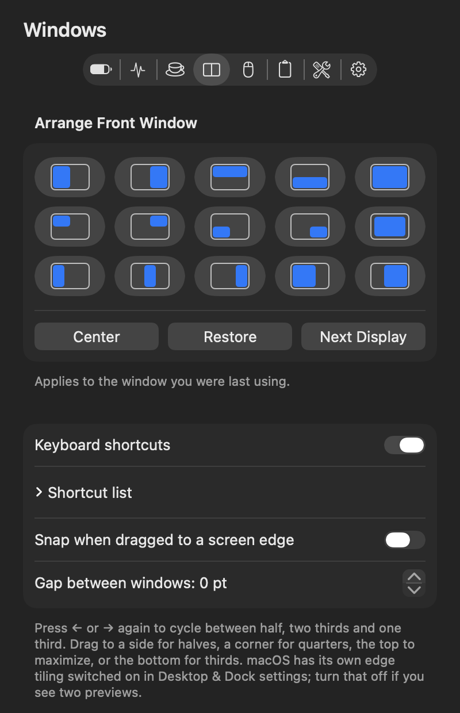
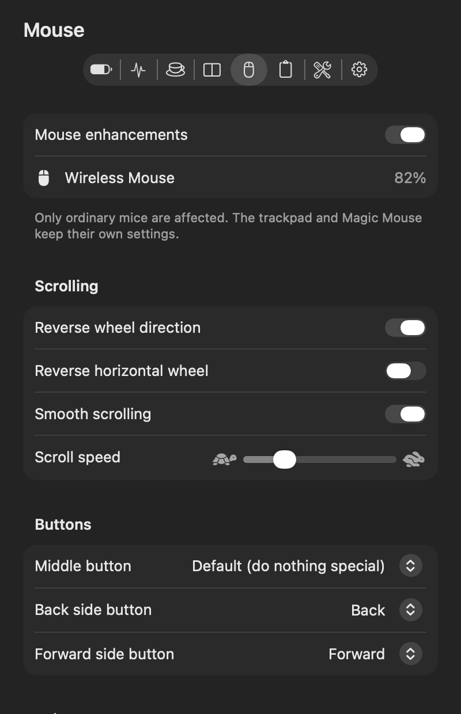
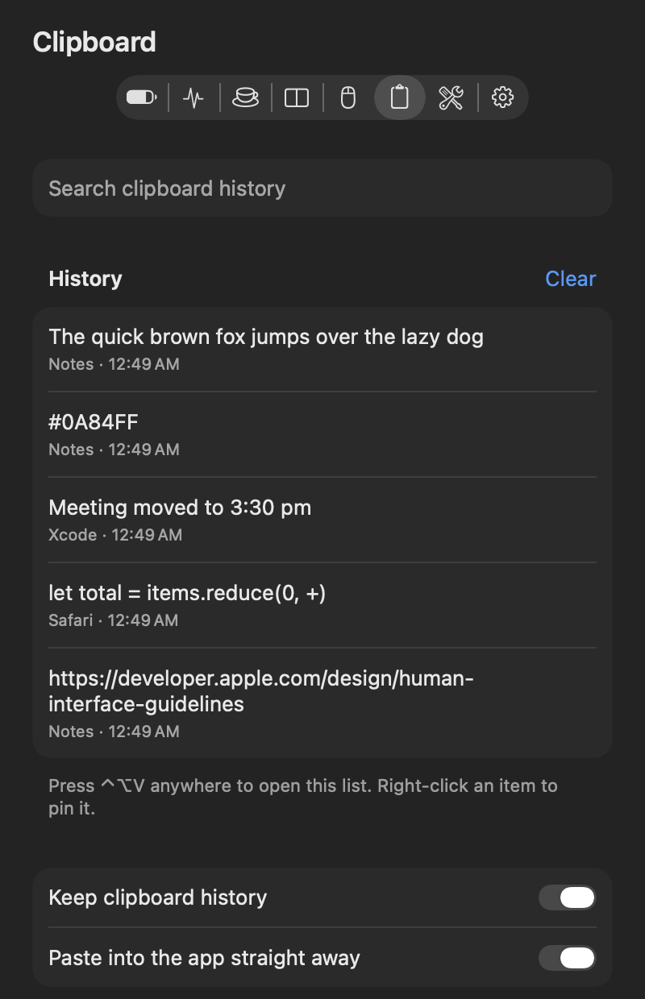
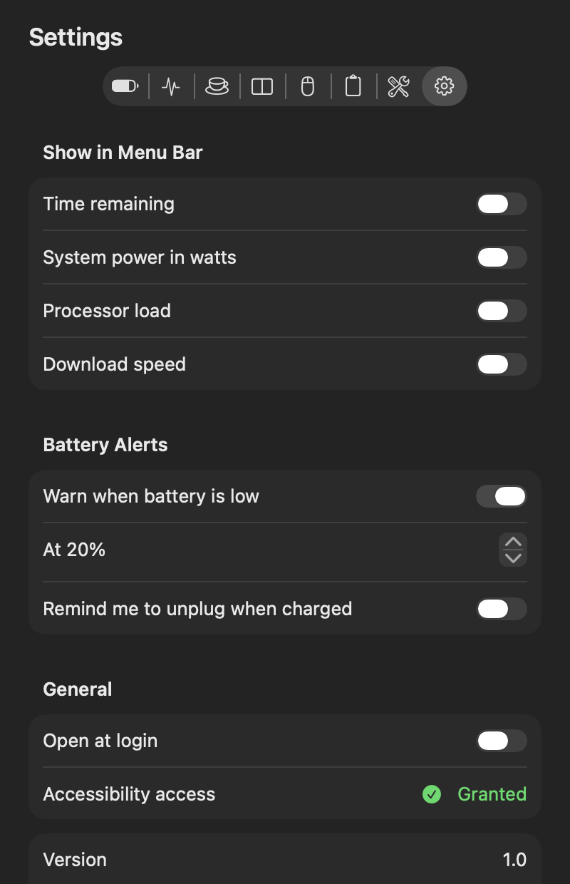
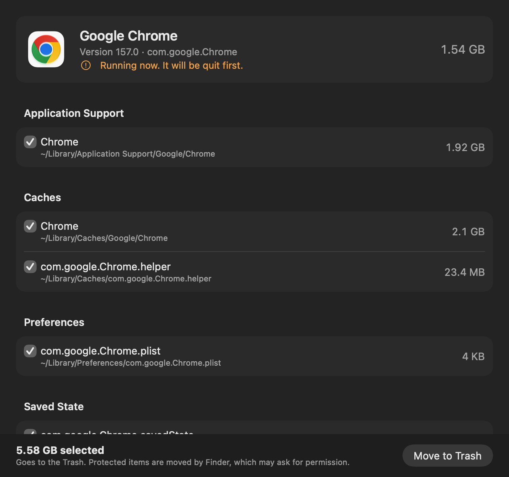
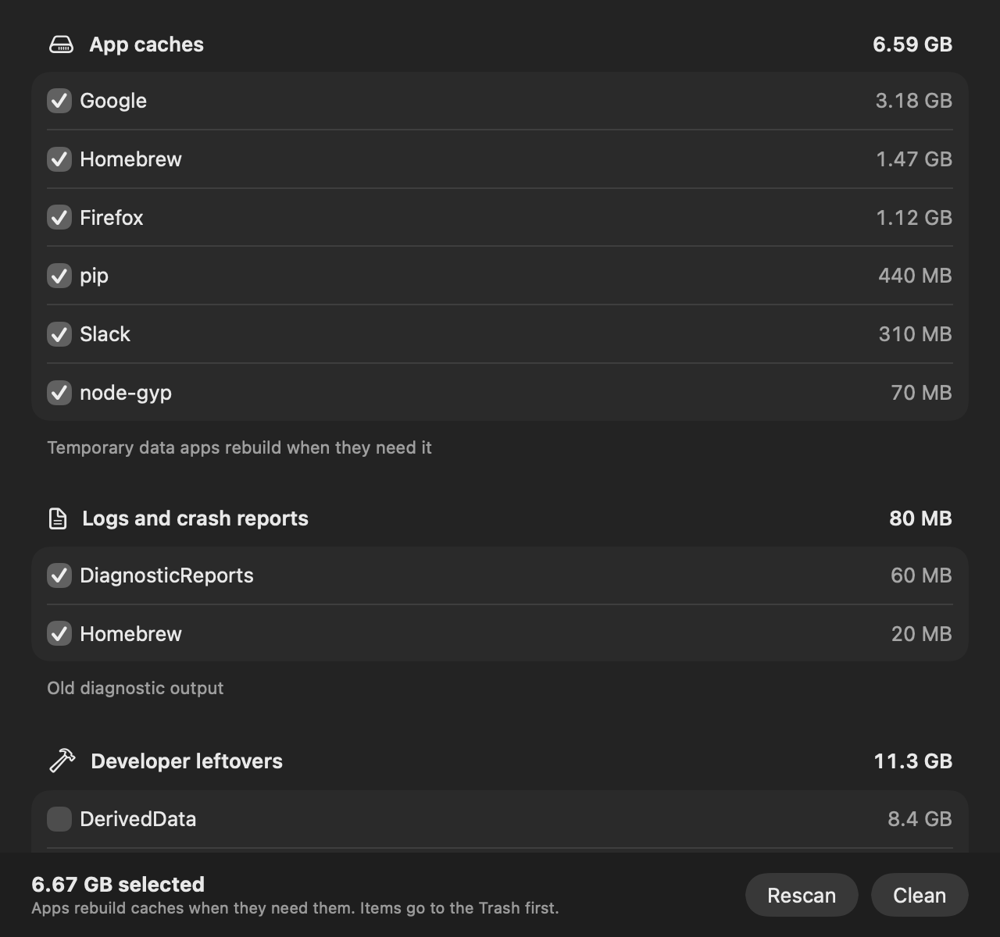

<div align="center">


# MacMate — The All-in-One macOS Menu Bar Tool

**Battery and per-app energy monitor · Window tiling manager · Third-party mouse fixes · Keep awake · System monitor · Deep app uninstaller · Clipboard history · Alt-Tab window switcher**

One free, open-source, native Swift app that replaces a dozen separate Mac utilities.

[](https://github.com/PriyanshuGeTRekT/macos-all-in-one-tool/releases/latest)
[](https://github.com/PriyanshuGeTRekT/macos-all-in-one-tool/releases)
[](https://github.com/PriyanshuGeTRekT/macos-all-in-one-tool/stargazers)
[](https://github.com/PriyanshuGeTRekT/macos-all-in-one-tool/forks)
[](https://hits.sh/github.com/PriyanshuGeTRekT/macos-all-in-one-tool/)

[](https://github.com/PriyanshuGeTRekT/macos-all-in-one-tool/issues)
[](https://github.com/PriyanshuGeTRekT/macos-all-in-one-tool/commits/main)
[](LICENSE)


[**Download**](https://github.com/PriyanshuGeTRekT/macos-all-in-one-tool/releases/latest) · [Features](#features) · [Screenshots](#screenshots) · [Install](#installation) · [Shortcuts](#keyboard-shortcuts) · [FAQ](#faq)

<br>





</div>

---

## What is MacMate?

MacMate is a lightweight **all-in-one macOS utility** that lives in your menu bar. It shows your **battery percentage** at a glance, and one click opens a panel that tells you **exactly which app is using how much energy** — in real watts, not a vague "energy impact" score — and how quickly each one is draining your MacBook.

From the same panel you also get the tools macOS still does not ship with: a **window tiling manager** like the one in Windows, proper support for **third-party mice**, a **keep-awake** timer, a live **system resource monitor**, an **app uninstaller that removes leftover files**, a **clipboard history**, and more.

It is written in Swift with SwiftUI and AppKit, uses the system's own controls and Liquid Glass materials, and is designed to look and feel like part of macOS.

- **Native.** No Electron, no web views, no background helpers.
- **Light.** About 0% CPU and 14 MB of memory while idle (measured on a MacBook Pro M2 Pro).
- **Private.** No network access, no analytics, no accounts. Nothing leaves your Mac.
- **Free and open source.** MIT licensed.

## Table of contents

- [Features](#features)
- [Apps MacMate can replace](#apps-macmate-can-replace)
- [Screenshots](#screenshots)
- [Requirements](#requirements)
- [Installation](#installation)
- [First-run setup](#first-run-setup)
- [Keyboard shortcuts](#keyboard-shortcuts)
- [How the energy measurement works](#how-the-energy-measurement-works)
- [Privacy and safety](#privacy-and-safety)
- [Known limitations](#known-limitations)
- [FAQ](#faq)
- [Roadmap](#roadmap)
- [Contributing](#contributing)
- [Star history](#star-history)
- [License](#license)

## Features

### 🔋 Battery monitor with per-app energy usage

- Battery percentage in the menu bar, with optional time remaining, system watts, CPU load and download speed.
- Live **system power draw in watts** and **drain rate in percent per hour**.
- **Energy by app in real watts**, read from the chip's own per-process energy counters.
- For every app: how many **percent per hour** it costs and **how many minutes of battery life** you would get back by quitting it.
- "Now" and "Since Unplugged" views, so you can see what actually drained the battery.
- Helper processes are grouped under their parent app (all of a browser's helpers count as the browser).
- Battery health: maximum capacity, cycle count, charge in mAh, adapter wattage.
- Low-battery warning and an optional "unplug at 80%" reminder.

### 🪟 Window manager and tiling (Windows-style snapping for Mac)

- 15 layouts: halves, quarters, thirds, two-thirds, maximize, almost-maximize, center.
- Global keyboard shortcuts on `⌃⌥` plus a key.
- Press the same half again to cycle **½ → ⅔ → ⅓**.
- **Drag a window to a screen edge or corner to snap it**, with a live preview.
- Restore the previous size, move a window to the next display, optional gaps between windows.
- **`⌥Tab` window switcher** that cycles through individual windows, not just apps.

### 🖱️ Third-party mouse support

- Detects non-Apple mice automatically when they are plugged in or paired.
- **Reverse scroll direction for the mouse only**, so the trackpad keeps natural scrolling.
- **Smooth scrolling** for ordinary wheel mice.
- Adjustable scroll speed.
- **Remap the middle, back and forward buttons**: Back, Forward, Mission Control, App windows, Show desktop, switch Spaces, Copy, Paste, Close tab, Play/Pause.
- Separate pointer speed and an option to turn off pointer acceleration.
- The trackpad and Magic Mouse are never touched.

### ☕ Keep awake

- Stop your Mac and display from sleeping for 15 minutes to 8 hours, a custom time, or **indefinitely**.
- Choose whether the display stays on or only the system.
- Optional automatic stop when the battery drops to 10%.

### 📊 System resource monitor

- CPU usage with history graph and per-core bars (efficiency and performance cores).
- Memory used, memory pressure, app/wired/compressed memory and swap.
- Network download and upload speed with history.
- GPU utilisation, storage, thermal state and uptime.
- Top processes by CPU or memory, with right-click to quit.

### 🗑️ App uninstaller that removes leftover files

- Lists every removable app with its size.
- Finds the app's **leftover files**: application support, caches, preferences, logs, saved state, containers, group containers, web data, launch agents and daemons.
- Review everything with checkboxes before anything is removed.
- **Everything is moved to the Trash, never deleted outright**, so you can put it back.
- Strict safety rules: nothing outside known app-data folders can ever be removed.

### ✨ Junk cleaner

- App caches, logs, crash reports, Xcode DerivedData and package-manager caches (npm, pip, Gradle, Cargo).
- Apple's own caches are left alone.
- Items go to the Trash first.

### 📋 Clipboard history

- Remembers the last 100 text items you copied, with search and pinning.
- Open anywhere with `⌃⌥V`, click to paste straight into the app you were using.
- Kept in memory only. Passwords copied from password managers are never recorded.

### 🧰 More tools macOS is missing

- **Copy text from anywhere on screen** (OCR): drag over an image, video or PDF and the text lands on the clipboard.
- **Color picker**: copy the hex value of any pixel.
- **Global microphone mute** with a hotkey.
- **Keyboard cleaning lock**: ignore all keys while you wipe the keyboard.
- **Hold `⌘Q` to quit**, so you never quit an app by accident.
- **Cut and paste files in Finder** with `⌘X` and `⌘V`.
- **Display dimming** in software, which also works on external monitors macOS cannot dim.
- Quick toggles: show hidden files, hide desktop icons, dark appearance, sleep display, eject all disks, restart Finder or Dock.
- Open at login.

## Apps MacMate can replace

| If you use… | MacMate section |
|---|---|
| Battery and energy monitors (coconutBattery, Stats, iStat Menus) | Battery, Activity |
| Window managers (Rectangle, Magnet) | Windows |
| Window switchers (AltTab) | Windows › `⌥Tab` |
| Mouse utilities (LinearMouse, Mac Mouse Fix, Mos, Scroll Reverser) | Mouse |
| Keep-awake tools (Amphetamine, Caffeine, `caffeinate`) | Keep Awake |
| Uninstallers and cleaners (AppCleaner, CleanMyMac) | Tools › Uninstall Apps, Clean Up Junk |
| Clipboard managers (Maccy, Paste) | Clipboard |
| Text capture (TextSniper) | Tools › Copy Text |
| Small helpers (keyboard cleaners, mic mute, slow quit, Finder cut/paste) | Tools |

MacMate warns you if one of these is running at the same time and would conflict with it.

## Screenshots

| Battery and energy by app | Activity monitor | Keep awake |
|:---:|:---:|:---:|
|  |  |  |

| Window tiling | Mouse settings | Clipboard history |
|:---:|:---:|:---:|
|  |  |  |

| Tools | Settings |
|:---:|:---:|
|  |  |

| App uninstaller with leftover files | Junk cleaner |
|:---:|:---:|
|  |  |

<sub>Screenshots are rendered by the app with sample data.</sub>

## Requirements

- **macOS 26 or later** (built and tested on macOS 27).
- **Apple silicon** Mac (M1 or newer). Per-app energy uses counters that only Apple silicon provides.
- To build from source: the Xcode Command Line Tools. Full Xcode is not needed.

## Installation

### Option 1 — Download the app

1. Download `MacMate-1.0.0.zip` from the [latest release](https://github.com/PriyanshuGeTRekT/macos-all-in-one-tool/releases/latest).
2. Unzip it and drag **MacMate.app** into your **Applications** folder.
3. Open MacMate. Because the app is not notarized by Apple, macOS blocks the first launch:
   - Open **System Settings › Privacy & Security**, scroll down and click **Open Anyway** next to MacMate, or
   - run this once in Terminal:
     ```bash
     xattr -dr com.apple.quarantine /Applications/MacMate.app
     ```
4. The battery icon and percentage appear in your menu bar. Click it to open the panel.

### Option 2 — Build from source

1. Install the Command Line Tools if you do not have them:
   ```bash
   xcode-select --install
   ```
2. Clone the repository:
   ```bash
   git clone https://github.com/PriyanshuGeTRekT/macos-all-in-one-tool.git
   ```
3. Build the app:
   ```bash
   cd macos-all-in-one-tool && ./build.sh
   ```
4. Copy it into Applications and open it:
   ```bash
   ditto dist/MacMate.app /Applications/MacMate.app && open /Applications/MacMate.app
   ```

A build you make yourself is not quarantined, so there is no Gatekeeper prompt.

To check that everything works on your hardware, run the built-in self-test:

```bash
dist/MacMate.app/Contents/MacOS/MacMate --selftest
```

## First-run setup

1. **Grant Accessibility access.** Open the **Windows** or **Mouse** section and click **Open Privacy & Security Settings**, then switch MacMate on. This is needed for window tiling, mouse fixes, `⌥Tab`, the `⌘Q` guard, Finder cut-and-paste and the keyboard lock. It takes effect within a couple of seconds; no restart needed.
2. **Turn on Open at Login** in **Settings** if you want MacMate to start with your Mac.
3. **Allow Screen Recording** the first time you use **Copy Text**; macOS asks for it automatically.
4. Quit any app that does the same job (see the table above). MacMate tells you if it finds one running.

Battery, energy, activity, keep-awake, clipboard and the cleaners work without any permission.

## Keyboard shortcuts

### Windows (`⌃⌥` + key)

| Shortcut | Action | Shortcut | Action |
|---|---|---|---|
| `⌃⌥←` | Left half | `⌃⌥→` | Right half |
| `⌃⌥↑` | Top half | `⌃⌥↓` | Bottom half |
| `⌃⌥U` | Top left | `⌃⌥I` | Top right |
| `⌃⌥J` | Bottom left | `⌃⌥K` | Bottom right |
| `⌃⌥D` | Left third | `⌃⌥F` | Center third |
| `⌃⌥G` | Right third | `⌃⌥E` | Left two thirds |
| `⌃⌥T` | Right two thirds | `⌃⌥↩` | Maximize |
| `⌃⌥M` | Almost maximize | `⌃⌥C` | Center |
| `⌃⌥⌫` | Restore | `⌃⌥N` | Next display |

### Tools

| Shortcut | Action |
|---|---|
| `⌃⌥V` | Open clipboard history |
| `⌃⌥O` | Copy text from the screen (OCR) |
| `⌃⌥A` | Mute or unmute the microphone |
| `⌃⌥P` | Pick a color |
| `⌥Tab` | Switch windows (when enabled) |

## How the energy measurement works

Most tools estimate an "energy impact" from CPU usage. MacMate reads the **actual energy in joules** that the processor spent on each process, using the kernel's per-process energy counters, and divides the change by time to get **watts**.

Whole-system power comes from the battery's own telemetry. From those two numbers MacMate works out:

- **Percent per hour** — an app's watts divided by your battery's real capacity.
- **Battery life cost** — how much longer the battery would last without that app at the current load.

The per-app figures cover processor energy. The display, graphics, radios and the rest of the hardware are shown together as system power, which is usually the larger share.

## Privacy and safety

- MacMate makes **no network connections** and collects nothing.
- Clipboard history lives **in memory only** and is cleared when the app quits.
- The uninstaller and junk cleaner **move items to the Trash**; they never delete directly.
- Removal is limited to app bundles and items inside known app-data folders. The home folder, documents, system files and the Library folders themselves can never be selected.
- The source is small and readable. Check it yourself.

## Known limitations

- **Not notarized.** The download needs the one-time "Open Anyway" step. Building from source avoids it.
- **Per-app energy is processor energy.** GPU and display power are not attributed to individual apps, and system processes owned by other users cannot be read without administrator rights.
- **Pointer speed and acceleration settings are experimental** and may not apply to every mouse.
- **Protected folders.** macOS hides some app data (for example browser profiles) from other apps. MacMate labels these "Protected" and asks Finder to move them.
- **Not included:** hiding menu bar icons, per-app volume, and hardware (DDC) brightness for external monitors.
- Rebuilding the app changes its signature, so macOS asks for Accessibility access again.

## FAQ

**How do I show battery percentage in the Mac menu bar?**
Install MacMate. The percentage is always visible, and you can add time remaining and watts in Settings.

**How can I see which app is draining my MacBook battery?**
Open the Battery section. Apps are ranked by real power draw, with the percent per hour each one costs. Switch to "Since Unplugged" to see the total since you left the charger.

**Is there a free window manager for Mac like Windows snap?**
Yes. MacMate includes halves, quarters and thirds with keyboard shortcuts and drag-to-edge snapping.

**How do I reverse mouse scrolling on Mac without changing the trackpad?**
Turn on "Reverse wheel direction" in the Mouse section. It affects ordinary mice only.

**How do I keep my Mac from sleeping?**
Open Keep Awake and pick a duration, or "Until I Turn It Off".

**How do I completely uninstall an app on Mac, including leftover files?**
Open Tools › Uninstall Apps, pick the app, review the files it found and click Move to Trash.

**Does MacMate work on Intel Macs?**
No. It needs Apple silicon and macOS 26 or later.

**Is it safe?**
It is open source, makes no network connections, and its cleaners only move things to the Trash.

## Roadmap

- Notarized builds and a Homebrew cask
- Customisable keyboard shortcuts
- Hardware brightness for external displays
- Per-app volume control
- Window thumbnails in the switcher

Ideas and bug reports are welcome in [Issues](https://github.com/PriyanshuGeTRekT/macos-all-in-one-tool/issues).

## Contributing

1. Fork the repository and create a branch.
2. Build with `./build.sh` and run `--selftest` before and after your change.
3. Open a pull request describing what changed and how you tested it.

Project layout:

```
Sources/MacMate/
├── App/        Entry point, menu bar item, self-test
├── Core/       Event tap, hotkeys, utilities
├── Services/   Battery, energy, system monitor, windows, mouse, uninstaller, tools
└── UI/         SwiftUI views for the panel and the Cleanup window
```

## Star history

If MacMate saves you from installing five other apps, a star helps other people find it.

[](https://star-history.com/#PriyanshuGeTRekT/macos-all-in-one-tool&Date)

## License

[MIT](LICENSE) © 2026 [Priyanshu Yadav](https://github.com/PriyanshuGeTRekT)

<div align="center">
<sub>MacMate — all-in-one macOS menu bar tool: battery monitor, energy usage per app, window manager, mouse fixes, keep awake, system monitor and app uninstaller.</sub>
</div>
