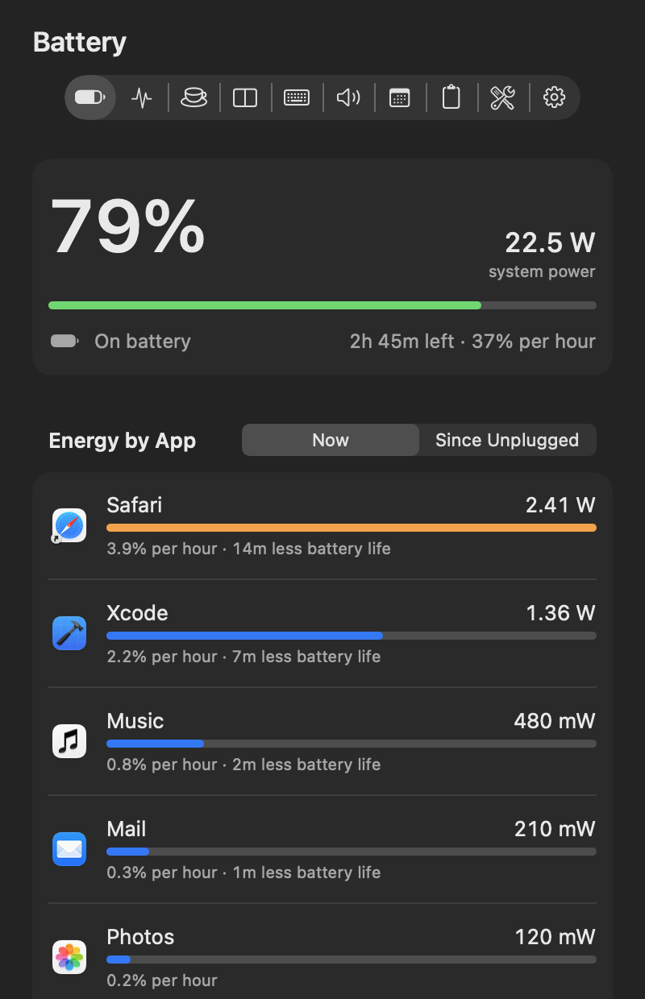
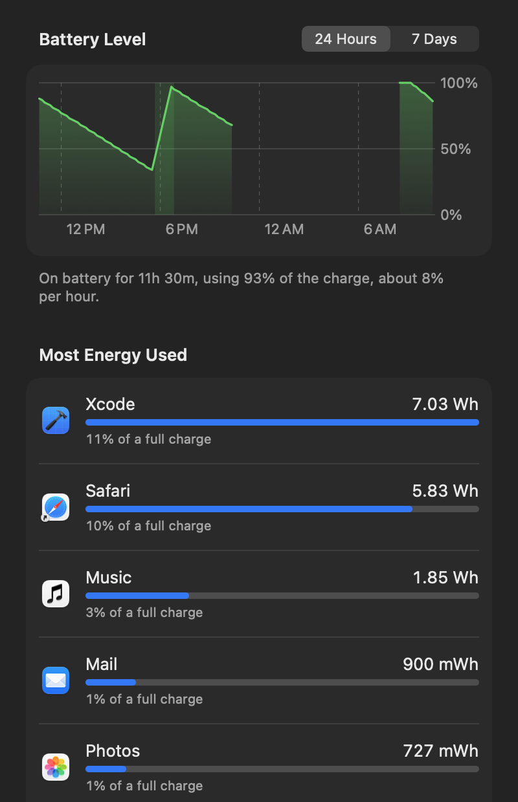
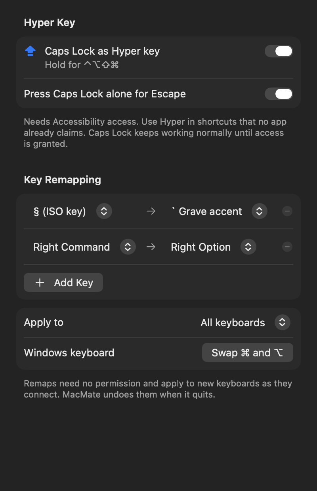
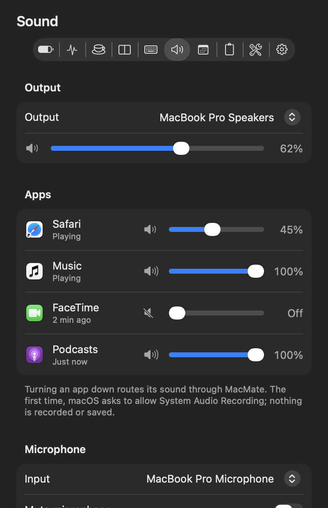
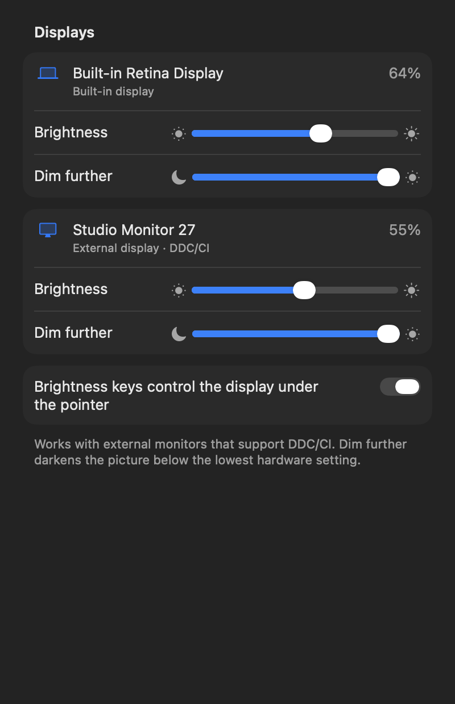
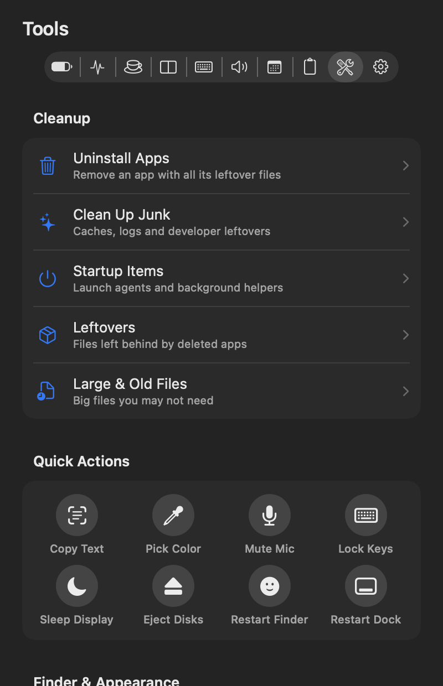
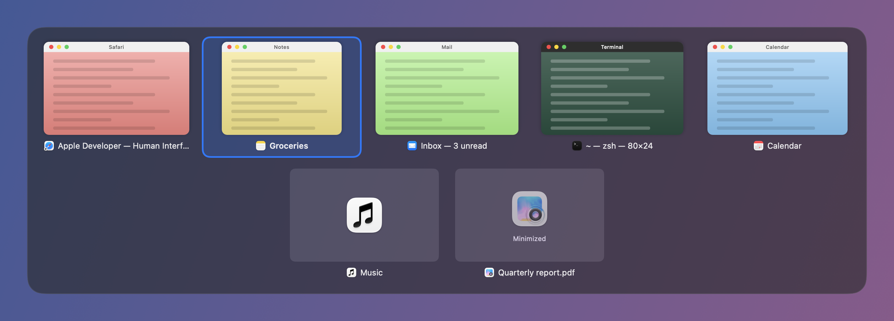
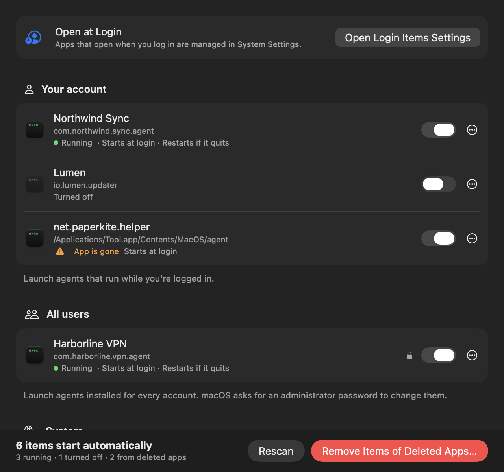

<div align="center">


# MacMate — The All-in-One macOS Menu Bar Tool

**Battery & per-app energy monitor · Battery history · Window tiling & Alt-Tab · Per-app volume · Mouse & keyboard fixes · Hyper key · External monitor brightness · Calendar · Keep awake · System monitor · App uninstaller & cleaner · Clipboard history**

One free, open-source, native Swift app that replaces a dozen separate Mac utilities.

[](https://github.com/PriyanshuGeTRekT/macos-all-in-one-tool/releases/latest)
[](https://github.com/PriyanshuGeTRekT/macos-all-in-one-tool/releases)
[](https://github.com/PriyanshuGeTRekT/macos-all-in-one-tool/stargazers)
[](https://github.com/PriyanshuGeTRekT/macos-all-in-one-tool/forks)
[](https://hits.sh/github.com/PriyanshuGeTRekT/macos-all-in-one-tool/)
[](https://github.com/PriyanshuGeTRekT/macos-all-in-one-tool/actions/workflows/build.yml)

[](https://github.com/PriyanshuGeTRekT/macos-all-in-one-tool/issues)
[](https://github.com/PriyanshuGeTRekT/macos-all-in-one-tool/commits/main)
[](LICENSE)


[](#option-2--homebrew)

[**Download**](https://github.com/PriyanshuGeTRekT/macos-all-in-one-tool/releases/latest/download/MacMate.zip) · [Website](https://priyanshugetrekt.github.io/macos-all-in-one-tool/) · [Features](#features) · [Screenshots](#screenshots) · [Install](#installation) · [Shortcuts](#keyboard-shortcuts) · [FAQ](#faq)

<br>


</div>

---

## What is MacMate?

MacMate is a lightweight **all-in-one macOS utility** that lives in your menu bar. It shows your **battery percentage** at a glance, and one click opens a panel that tells you **exactly which app is using how much energy** — in real watts, not a vague "energy impact" score — how quickly each one is draining your MacBook, and what drained it over the last day or week.

From the same panel you get the tools macOS still doesn't ship: **Windows-style window tiling and Alt-Tab**, **per-app volume**, proper support for **third-party mice and keyboards**, **brightness for external monitors**, a **keep-awake** timer, a live **system monitor**, your **next meeting**, an **app uninstaller that removes leftover files**, a **clipboard history**, and more.

It is written in Swift with SwiftUI and AppKit, uses the system's own controls and Liquid Glass materials, and is designed to look and feel like part of macOS.

- **Native.** No Electron, no web views, no background helpers.
- **Light.** About 0% CPU and 15 MB of memory while idle (measured on a MacBook Pro M2 Pro).
- **Private.** No analytics, no accounts. The only network request is the update check to GitHub, and you can turn it off.
- **Free and open source.** MIT licensed.

## Table of contents

- [Features](#features)
- [Apps MacMate can replace](#apps-macmate-can-replace)
- [Screenshots](#screenshots)
- [Requirements](#requirements)
- [Installation](#installation)
- [First-run setup and permissions](#first-run-setup-and-permissions)
- [Keyboard shortcuts](#keyboard-shortcuts)
- [How the energy measurement works](#how-the-energy-measurement-works)
- [Privacy and safety](#privacy-and-safety)
- [Known limitations](#known-limitations)
- [FAQ](#faq)
- [Roadmap](#roadmap)
- [Contributing](#contributing)
- [Star history](#star-history)
- [License](#license)

## Features

### 🔋 Battery monitor with per-app energy usage

- Battery percentage in the menu bar, with optional time remaining, system watts, CPU load, download speed and your next meeting.
- Live **system power draw in watts** and **drain rate in percent per hour**.
- **Energy by app in real watts**, read from the chip's own per-process energy counters.
- For every app: how many **percent per hour** it costs and **how many minutes of battery life** you'd get back by quitting it.
- "Now" and "Since Unplugged" views; helper processes are grouped under their parent app.
- **Battery history:** charge level over the last **24 hours or 7 days**, with charging periods marked, plus the apps that used the **most energy** in that time.
- **Energy alerts:** a notification when an app suddenly uses far more power than usual while you're on battery.
- **Device batteries:** AirPods (each bud and the case), mice, keyboards and trackpads.
- Battery health: maximum capacity, cycle count, charge in mAh, adapter wattage. Low-battery and "unplug now" reminders.

### 🪟 Window manager, Alt-Tab and window previews

- 15 layouts: halves, quarters, thirds, two-thirds, maximize, almost-maximize, center — on **customizable keyboard shortcuts**.
- Press the same half again to cycle **½ → ⅔ → ⅓**.
- **Drag a window to a screen edge or corner to snap it**, with a live preview.
- Restore the previous size, move a window to the next display, optional gaps between windows.
- **`⌥Tab` window switcher** that cycles individual windows, with **live window thumbnails** in a grid.
- **Dock previews:** hover an app in the Dock to see its windows and jump straight to one.

### 🔊 Per-app volume

- Turn any app up, down or mute it without touching the others.
- Switch the output and input device and set the output volume from the panel.
- Settings are remembered and re-applied whenever the app plays sound again.

### 🖱️ ⌨️ Mouse & keyboard

- Detects non-Apple mice automatically; **reverse scroll for the mouse only**, **smooth scrolling**, scroll speed.
- **Remap the middle, back and forward buttons** (Back, Forward, Mission Control, Show desktop, switch Spaces, Copy, Paste, Play/Pause…).
- Separate pointer speed and an option to turn off pointer acceleration.
- **Caps Lock as a Hyper key** (⌃⌥⇧⌘ while held, Escape when tapped).
- **Key remapping** for all keyboards or external ones only, with a one-click **swap ⌘ and ⌥** for Windows keyboards.
- **Hold `⌘Q` to quit** and **cut and paste files in Finder** with `⌘X` / `⌘V`.

### 🖥️ Displays

- **Hardware brightness for external monitors over DDC/CI** — no more fiddling with the monitor's buttons.
- **Brightness keys control the display under the pointer.**
- Built-in display brightness, and "Dim further" below the hardware minimum on any screen.

### 📅 Calendar

- Today's and tomorrow's events, the **next meeting with a one-click Join button** (Zoom, Google Meet, Teams, Webex, FaceTime, Slack and more).
- Optional **meeting countdown in the menu bar** and alerts before meetings.

### ☕ Keep awake

- Stop your Mac and display from sleeping for 15 minutes to 8 hours, a custom time, or **indefinitely**, with an optional automatic stop at 10% battery.

### 📊 System resource monitor

- CPU with history graph and per-core bars, memory and pressure, swap, network speed, GPU, storage, thermal state, uptime, top processes.

### 🧹 Uninstaller and cleanup

- **Uninstall apps completely:** finds the app's leftover files (support files, caches, preferences, containers, launch agents…) for you to review.
- **Junk cleaner** for caches, logs and developer leftovers.
- **Startup items:** see and turn off launch agents and background helpers, and spot ones whose app is gone.
- **Leftovers:** files left behind by apps you already deleted.
- **Large & old files:** find big files, or ones you haven't opened in over a year.
- Everything is **moved to the Trash, never deleted outright**.

### 📋 Clipboard history and more

- Clipboard history (last 100 text items) with search and pinning; passwords from password managers are never recorded.
- **Copy text from anywhere on screen** (OCR), **color picker**, **global microphone mute**, **keyboard cleaning lock**.
- Quick toggles: hidden files, desktop icons, dark mode, sleep display, eject all disks, restart Finder or Dock.
- **In-app updates**, open at login, and every global shortcut can be changed.

## Apps MacMate can replace

| If you use… | MacMate section |
|---|---|
| coconutBattery, Stats, iStat Menus, AirBuddy | Battery, Activity |
| Rectangle, Magnet | Windows |
| AltTab, DockDoor | Windows › `⌥Tab` and Dock previews |
| SoundSource, FineTune, Background Music | Sound |
| LinearMouse, Mac Mouse Fix, Mos, Scroll Reverser | Mouse & Keyboard |
| Hyperkey, Karabiner-Elements (simple remaps) | Mouse & Keyboard |
| MonitorControl, Lunar | Tools › Displays |
| MeetingBar, Itsycal | Calendar |
| Amphetamine, Caffeine | Keep Awake |
| AppCleaner, CleanMyMac, LaunchControl, DaisyDisk | Tools › Cleanup |
| Maccy, Paste, TextSniper | Clipboard, Tools |

MacMate warns you if a conflicting app is running at the same time.

## Screenshots

| Battery & energy by app | Battery history | Activity |
|:---:|:---:|:---:|
|  |  |  |

| Window tiling | Mouse & keyboard | Hyper key & key remapping |
|:---:|:---:|:---:|
|  |  |  |

| Per-app volume | Calendar & next meeting | External display brightness |
|:---:|:---:|:---:|
|  |  |  |

| Keep awake | Clipboard history | Tools |
|:---:|:---:|:---:|
|  |  |  |

**⌥Tab window switcher with thumbnails**



| App uninstaller with leftover files | Junk cleaner |
|:---:|:---:|
|  |  |

| Startup items | Leftovers of deleted apps | Large & old files |
|:---:|:---:|:---:|
|  |  |  |

<sub>Screenshots and the demo are rendered by the app itself with sample data, so no personal information appears in them.</sub>

## Requirements

- **macOS 26 or later** (built and tested on macOS 27).
- **Apple silicon** Mac (M1 or newer). Per-app energy and DDC brightness use features only Apple silicon provides.
- To build from source: the Xcode Command Line Tools. Full Xcode is not needed.

## Installation

### Option 1 — Download the app

1. Download **[MacMate.zip](https://github.com/PriyanshuGeTRekT/macos-all-in-one-tool/releases/latest/download/MacMate.zip)** from the latest release.
2. Unzip it and drag **MacMate.app** into your **Applications** folder.
3. Open MacMate. Because the app isn't notarized by Apple, macOS blocks the first launch:
   - open **System Settings › Privacy & Security**, scroll down and click **Open Anyway** next to MacMate, or
   - run this once in Terminal:
     ```bash
     xattr -dr com.apple.quarantine /Applications/MacMate.app
     ```
4. The battery icon and percentage appear in your menu bar. Click it to open the panel.

### Option 2 — Homebrew

```bash
brew tap priyanshugetrekt/macmate https://github.com/PriyanshuGeTRekT/macos-all-in-one-tool
```

```bash
brew install --cask priyanshugetrekt/macmate/macmate
```

The first launch still needs **Open Anyway** (step 3 above).

### Option 3 — Build from source

1. Install the Command Line Tools if you don't have them:
   ```bash
   xcode-select --install
   ```
2. Clone the repository:
   ```bash
   git clone https://github.com/PriyanshuGeTRekT/macos-all-in-one-tool.git
   ```
3. Build the app:
   ```bash
   cd macos-all-in-one-tool && ./build.sh
   ```
4. Copy it into Applications and open it:
   ```bash
   ditto dist/MacMate.app /Applications/MacMate.app && open /Applications/MacMate.app
   ```

To check everything on your hardware, run the built-in self-test (over 400 checks):

```bash
dist/MacMate.app/Contents/MacOS/MacMate --selftest
```

### Updating

MacMate checks GitHub once a day and offers **Install and Relaunch** in **Settings** when a new version is out. You can also check by hand there, or turn automatic checks off.

## First-run setup and permissions

MacMate asks for each permission only when you use the feature that needs it.

| Permission | Needed for |
|---|---|
| **Accessibility** | Window tiling, `⌥Tab`, Dock previews, mouse fixes, Hyper key, `⌘Q` guard, Finder cut & paste, keyboard lock |
| **Screen Recording** | Window thumbnails in `⌥Tab` and the Dock, Copy Text (OCR) |
| **System Audio Recording** | Per-app volume (sound is routed through MacMate; nothing is recorded or saved) |
| **Calendars** | The Calendar tab and meeting countdown |

1. Open the **Windows** or **Mouse & Keyboard** section and click **Open Privacy & Security Settings**, then switch MacMate on. It takes effect within a couple of seconds.
2. Turn on **Open at Login** in **Settings** if you want MacMate to start with your Mac.
3. Quit any app that does the same job (see the table above). MacMate tells you if it finds one running.

Battery, history, activity, keep-awake, clipboard and the cleanup tools work without any permission.

## Keyboard shortcuts

Every shortcut can be changed or removed: window shortcuts under **Windows › Customize shortcuts**, the others under **Settings › Keyboard Shortcuts**. These are the defaults.

### Windows (`⌃⌥` + key)

| Shortcut | Action | Shortcut | Action |
|---|---|---|---|
| `⌃⌥←` | Left half | `⌃⌥→` | Right half |
| `⌃⌥↑` | Top half | `⌃⌥↓` | Bottom half |
| `⌃⌥U` | Top left | `⌃⌥I` | Top right |
| `⌃⌥J` | Bottom left | `⌃⌥K` | Bottom right |
| `⌃⌥D` | Left third | `⌃⌥F` | Center third |
| `⌃⌥G` | Right third | `⌃⌥E` | Left two thirds |
| `⌃⌥T` | Right two thirds | `⌃⌥↩` | Maximize |
| `⌃⌥M` | Almost maximize | `⌃⌥C` | Center |
| `⌃⌥⌫` | Restore | `⌃⌥N` | Next display |

### Tools

| Shortcut | Action |
|---|---|
| `⌃⌥V` | Open clipboard history |
| `⌃⌥O` | Copy text from the screen (OCR) |
| `⌃⌥A` | Mute or unmute the microphone |
| `⌃⌥P` | Pick a color |
| `⌥Tab` | Switch windows (when enabled) |
| *(unassigned)* | Open MacMate, toggle Keep Awake, lock the keyboard — assign them in Settings |

## How the energy measurement works

Most tools estimate an "energy impact" from CPU usage. MacMate reads the **actual energy in joules** that the processor spent on each process, using the kernel's per-process energy counters, and divides the change by time to get **watts**. Whole-system power comes from the battery's own telemetry.

From those two numbers MacMate works out:

- **Percent per hour** — an app's watts divided by your battery's real capacity.
- **Battery life cost** — how much longer the battery would last without that app at the current load.
- **History** — battery level and per-app energy are stored for 7 days in `~/Library/Application Support/MacMate`, on your Mac only.

The per-app figures cover processor energy. The display, graphics, radios and the rest of the hardware are shown together as system power, which is usually the larger share.

## Privacy and safety

- **One network request:** the daily update check to the GitHub Releases API. Turn it off in Settings. Nothing else leaves your Mac — no analytics, no accounts.
- Clipboard history lives **in memory only** and is cleared when the app quits.
- Per-app volume routes sound through MacMate in real time; **nothing is recorded or saved**.
- Calendar data is read on your Mac and never stored or sent anywhere.
- The uninstaller and cleanup tools **move items to the Trash**, never delete directly. Leftovers and large files start unselected, and removal is limited to safe locations: your home folder, documents, system files and the Library folders themselves can never be selected by the cleaners.
- Key remaps are undone when MacMate quits.
- The source is small and readable. Check it yourself.

## Known limitations

- **Not notarized.** The download needs the one-time "Open Anyway" step. Building from source avoids it.
- **Permissions after updates.** Builds are ad-hoc signed, so macOS may ask for Accessibility access again after an update.
- **Per-app energy is processor energy.** GPU and display power aren't attributed to individual apps.
- **External monitor brightness** needs a monitor that supports DDC/CI over the port you use (some docks and HDMI adapters block it); MacMate falls back to dimming in software.
- **Per-app volume** can briefly play an app at full volume (about a tenth of a second) before its saved level is re-applied.
- **Window thumbnails** need Screen Recording permission, which macOS applies after MacMate restarts; minimized windows and windows on other Spaces show the app icon.
- **Pointer speed and acceleration settings are experimental** and may not apply to every mouse.
- **Protected folders.** macOS hides some app data from other apps; MacMate labels these "Protected" and asks Finder to move them.
- **Not included:** hiding menu bar icons (macOS 27 changed how the menu bar works) and charge limiting (built into macOS).

## FAQ

**How do I show battery percentage in the Mac menu bar?**
Install MacMate. The percentage is always visible, and you can add time remaining and watts in Settings.

**How can I see which app is draining my MacBook battery?**
Open the Battery section. Apps are ranked by real power draw, with the percent per hour each one costs. The Battery Level chart shows the last 24 hours or 7 days and which apps used the most energy.

**Is there a free window manager for Mac like Windows snap and Alt-Tab?**
Yes. MacMate has halves, quarters and thirds with keyboard shortcuts and drag-to-edge snapping, plus an `⌥Tab` window switcher with thumbnails.

**Can I change the volume of one app on Mac?**
Yes. The Sound section has a volume slider and mute button for every app playing sound.

**How do I reverse mouse scrolling on Mac without changing the trackpad?**
Turn on "Reverse wheel direction" in the Mouse & Keyboard section. It affects ordinary mice only.

**How do I control an external monitor's brightness from my Mac?**
Open Tools › Displays. Monitors that support DDC/CI get a hardware brightness slider, and your brightness keys control the display under the pointer.

**How do I keep my Mac from sleeping?**
Open Keep Awake and pick a duration, or "Until I Turn It Off".

**How do I completely uninstall an app on Mac, including leftover files?**
Open Tools › Uninstall Apps, pick the app, review the files it found and click Move to Trash. Tools › Leftovers finds files from apps you've already deleted.

**Does MacMate work on Intel Macs?**
No. It needs Apple silicon and macOS 26 or later.

**Is it safe?**
It is open source, makes no network requests except the update check, and its cleaners only move things to the Trash.

## Roadmap

- Notarized builds
- Per-app volume boost above 100% and per-app output devices
- Window layouts you can save and restore
- More languages

Ideas and bug reports are welcome in [Issues](https://github.com/PriyanshuGeTRekT/macos-all-in-one-tool/issues).

## Contributing

See [CONTRIBUTING.md](CONTRIBUTING.md). In short: fork, build with `./build.sh`, run `--selftest` before and after your change, and open a pull request. Security issues: see [SECURITY.md](SECURITY.md).

Project layout:

```
Sources/MacMate/
├── App/        Entry point, menu bar item, self-test and screenshot renderer
├── Core/       Event tap, hotkeys, shortcuts, utilities
├── Services/   Battery, history, energy, system, windows, previews, audio, displays,
│               mouse, keyboard, calendar, uninstaller, cleanup, updater, tools
└── UI/         SwiftUI views for the panel and the Cleanup window
docs/           Website (GitHub Pages), screenshots, demo
Casks/          Homebrew cask
```

## Star history

If MacMate saves you from installing ten other apps, a star helps other people find it.

[](https://star-history.com/#PriyanshuGeTRekT/macos-all-in-one-tool&Date)

## License

[MIT](LICENSE) © 2026 [Priyanshu Yadav](https://github.com/PriyanshuGeTRekT)

<div align="center">
<sub>MacMate — all-in-one macOS menu bar tool: battery monitor, energy usage per app, battery history, window manager, Alt-Tab, per-app volume, mouse and keyboard fixes, external monitor brightness, calendar, keep awake, system monitor and app uninstaller.</sub>
</div>
