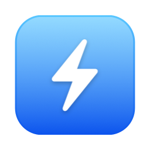
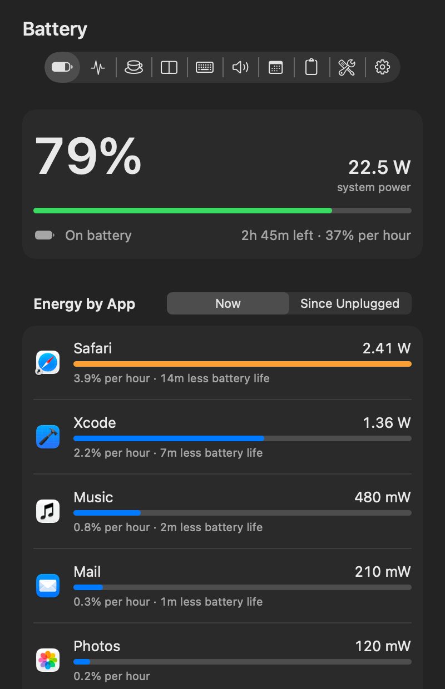
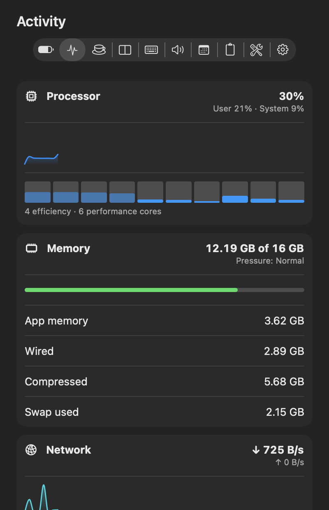
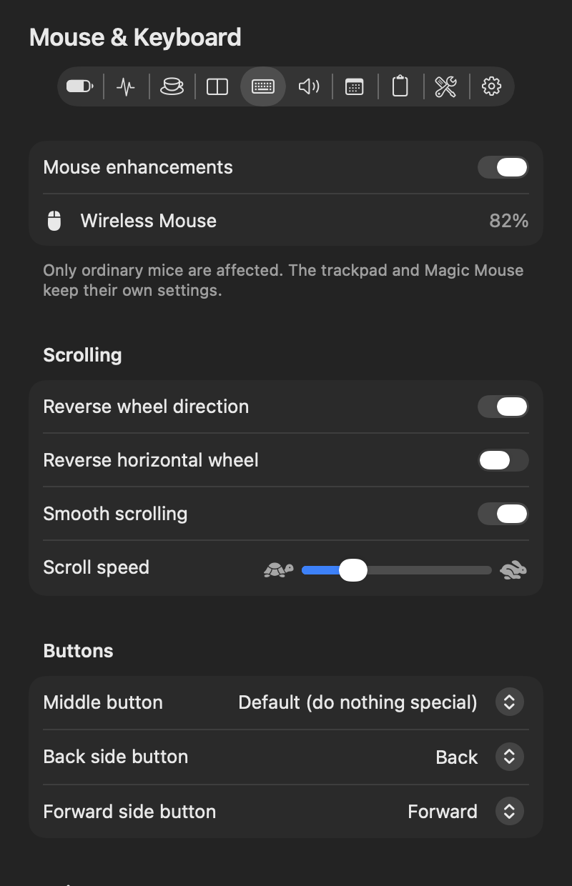
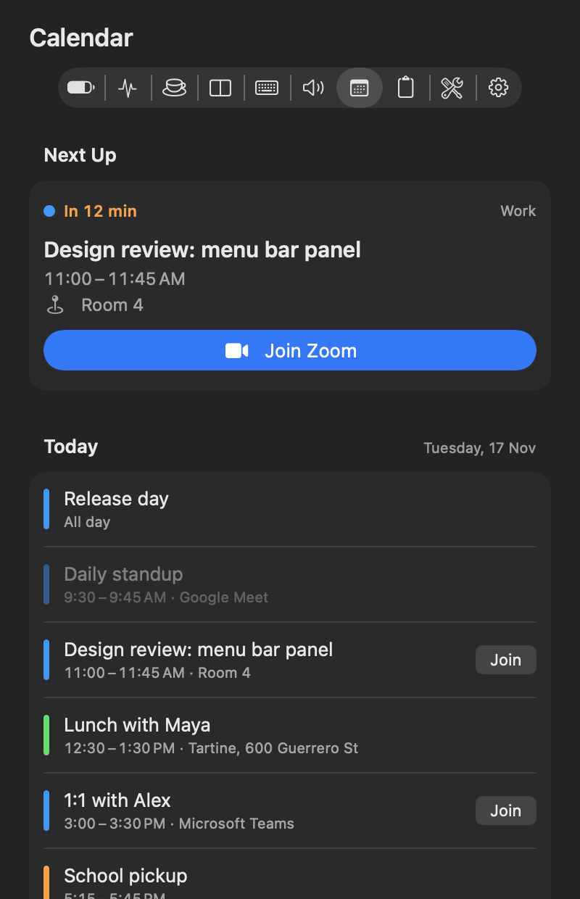
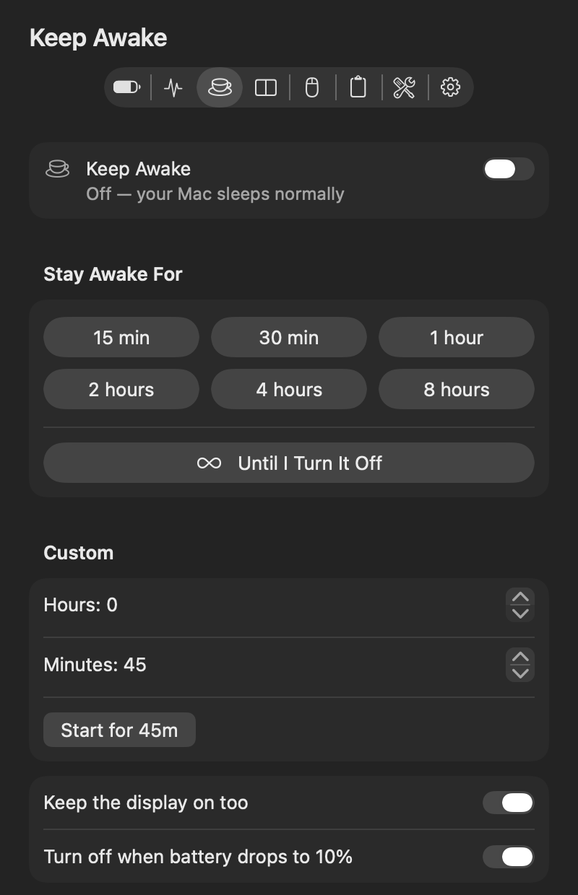
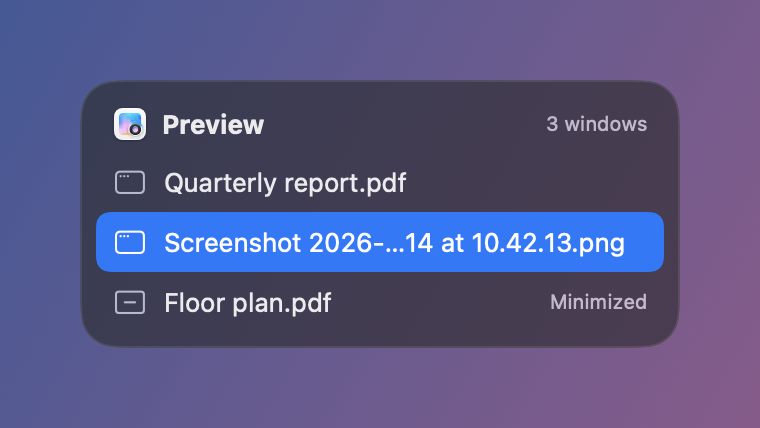
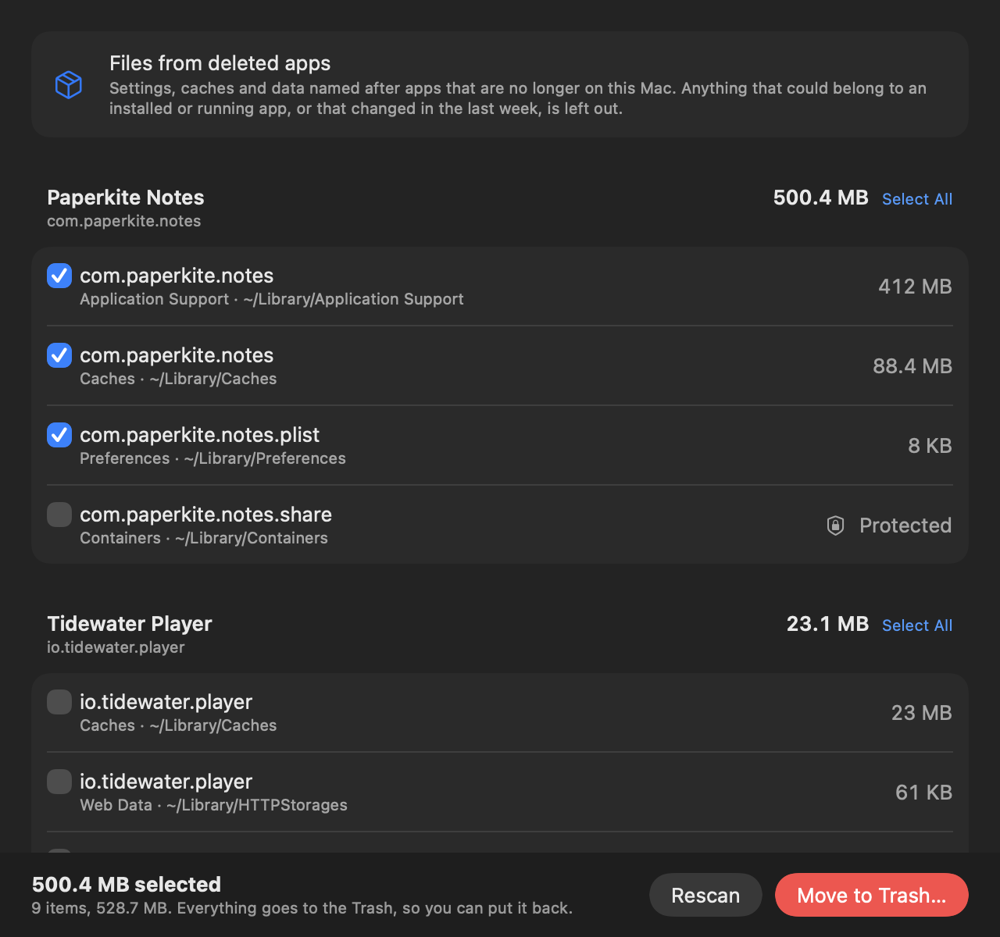
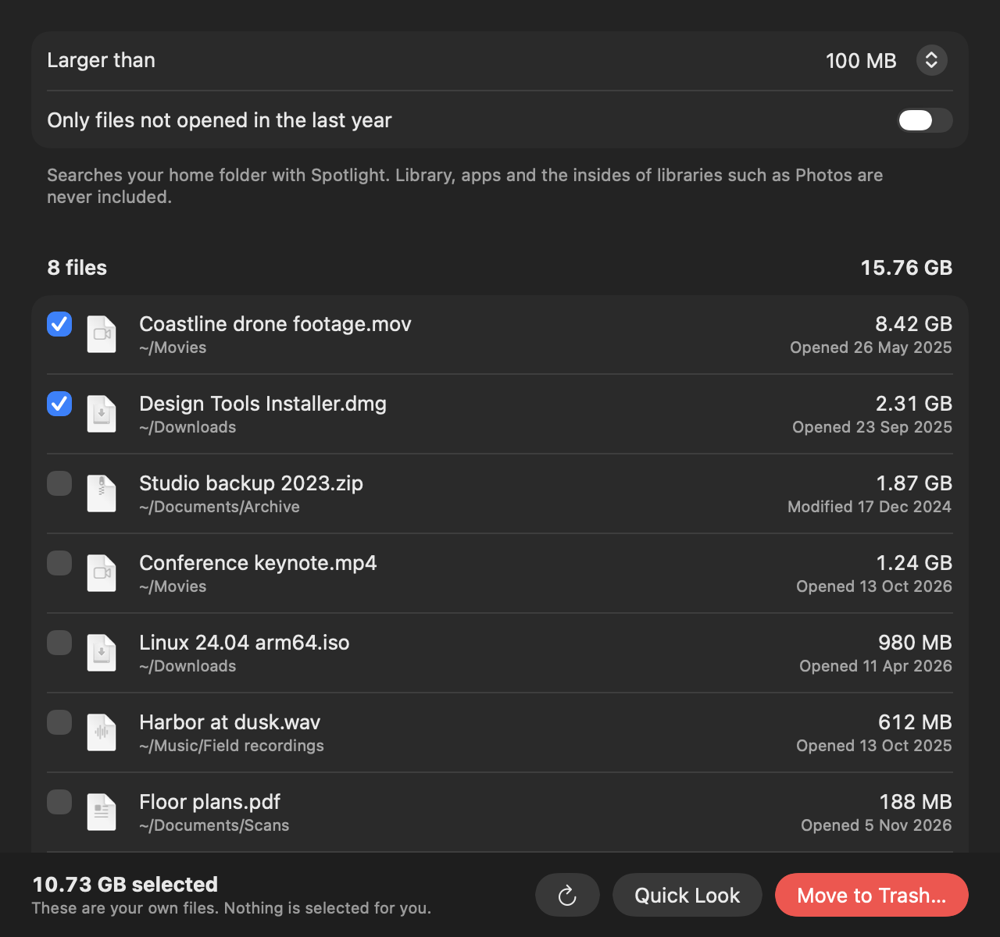

<div align="center">



# MacMate — Free All-in-One macOS Menu Bar Tool

### Battery monitor & per-app energy usage · Window manager & Alt-Tab · Per-app volume · Mouse & keyboard fixes · Hyper key · External monitor brightness · Keep awake · System monitor · App uninstaller & cleaner · Clipboard history · Calendar

**MacMate is a free, open-source, native Mac menu bar app that replaces a dozen separate macOS utilities with one lightweight Swift app.**

[](https://github.com/PriyanshuGeTRekT/macmate-macos-all-in-one-tool/releases/latest)
[](https://github.com/PriyanshuGeTRekT/macmate-macos-all-in-one-tool/releases)
[](https://github.com/PriyanshuGeTRekT/macmate-macos-all-in-one-tool/stargazers)
[](https://github.com/PriyanshuGeTRekT/macmate-macos-all-in-one-tool/forks)
[](https://hits.sh/github.com/PriyanshuGeTRekT/macos-all-in-one-tool/)
[](https://github.com/PriyanshuGeTRekT/macmate-macos-all-in-one-tool/actions/workflows/build.yml)

[](https://github.com/PriyanshuGeTRekT/macmate-macos-all-in-one-tool/issues)
[](https://github.com/PriyanshuGeTRekT/macmate-macos-all-in-one-tool/commits/main)
[](LICENSE)


[](#option-2--install-with-homebrew)

[**⬇️ Download MacMate**](https://github.com/PriyanshuGeTRekT/macmate-macos-all-in-one-tool/releases/latest/download/MacMate.zip) · [Website](https://priyanshugetrekt.github.io/macmate-macos-all-in-one-tool/) · [Features](#features) · [Screenshots](#screenshots) · [Install](#installation) · [Shortcuts](#keyboard-shortcuts) · [FAQ](#faq)

<br>



</div>

---

## What is MacMate?

**MacMate** is a lightweight **all-in-one macOS utility** that lives in your **menu bar**. It shows your **battery percentage** at a glance, and one click opens a panel that tells you **which app is draining your MacBook battery** — in real **watts**, not a vague "energy impact" score — how many **percent per hour** each app costs, and what used your battery over the **last 24 hours or 7 days**.

From the same panel you get the tools macOS still doesn't ship:

- **Windows-style window snapping and tiling** with keyboard shortcuts, plus a real **Alt-Tab window switcher** with live thumbnails and **Dock window previews**
- **Per-app volume control** and quick audio device switching
- Proper support for **third-party mice** (Logitech, Razer, Microsoft and others): reverse scroll for the mouse only, smooth scrolling, side-button remapping
- **Caps Lock as a Hyper key** and simple **key remapping**
- **Brightness control for external monitors** over DDC/CI
- A **keep-awake** timer (like Amphetamine or Caffeine) for any duration, or indefinitely
- A live **system resource monitor**: CPU, memory, GPU, network, disk, temperature
- A deep **app uninstaller** that finds **leftover files**, a **junk cleaner**, a **startup items** manager and a **large file finder**
- **Clipboard history**, **copy text from the screen (OCR)**, a **color picker**, a global **microphone mute**, your **next meeting** with a Join button, and more

MacMate is written in **Swift** with **SwiftUI** and **AppKit**, uses the system's own controls and **Liquid Glass** materials, and is designed to look and feel like part of macOS Tahoe and later.

| | |
|---|---|
| 🍏 **Native** | Swift, SwiftUI and AppKit. No Electron, no web views, no background helpers. |
| 🪶 **Lightweight** | About 0.1% CPU and 16 MB of memory while idle (measured on a MacBook Pro with M2 Pro). |
| 🔒 **Private** | No analytics, no accounts, no tracking. The only network request is the optional update check. |
| 💸 **Free & open source** | MIT licensed. No subscription, no paywall, no "Pro" tier. |
| 🧪 **Tested** | A built-in self-test runs more than 400 checks on your own hardware. |

## Table of contents

- [What is MacMate?](#what-is-macmate)
- [Features](#features)
- [Apps MacMate can replace](#apps-macmate-can-replace)
- [Screenshots](#screenshots)
- [Requirements](#requirements)
- [Installation](#installation)
- [First-run setup and permissions](#first-run-setup-and-permissions)
- [Keyboard shortcuts](#keyboard-shortcuts)
- [How the energy measurement works](#how-the-energy-measurement-works)
- [Privacy and safety](#privacy-and-safety)
- [Known limitations](#known-limitations)
- [FAQ](#faq)
- [Roadmap](#roadmap)
- [Contributing](#contributing)
- [Star history](#star-history)
- [License](#license)

## Features

### 🔋 Battery monitor & energy usage by app

- **Battery percentage in the Mac menu bar**, with optional **time remaining**, **system power in watts**, **CPU load**, **download speed** and your **next meeting**.
- Live **system power draw in watts** and **battery drain rate in percent per hour**.
- **Energy usage by app in real watts**, read from the Apple silicon chip's own per-process energy counters — far more precise than Activity Monitor's "Energy Impact".
- For every app: the **percent per hour** it costs and **how many minutes of battery life** you'd get back by quitting it. Quit a power-hungry app straight from the list.
- **"Now"** and **"Since Unplugged"** views; helper processes (renderers, GPU helpers, web content) are grouped under their parent app.
- **Battery history chart:** charge level over the last **24 hours** or **7 days**, with charging periods marked, the drain rate on battery, and the **apps that used the most energy** in that time.
- **Energy alerts:** a notification when an app suddenly draws far more power than usual while you're on battery — catch runaway processes before they drain your MacBook.
- **Bluetooth device batteries:** **AirPods** (left, right and case), **mice**, **keyboards** and **trackpads**, including Magic Mouse, Magic Keyboard and many third-party devices.
- **Battery health:** maximum capacity, **cycle count**, charge in mAh, **battery temperature** and power adapter wattage.
- **Low-battery warning** and an **"unplug now" reminder** when charged, to help battery longevity.

### 🪟 Window manager, Alt-Tab & Dock previews

- **15 window layouts:** left/right/top/bottom halves, four quarters, thirds, two-thirds, maximize, almost maximize and center — each on a **customizable keyboard shortcut**.
- Press the same half again to cycle its width **½ → ⅔ → ⅓**, just like Windows Snap.
- **Drag a window to a screen edge or corner to snap it**, with a live preview of where it will land.
- **Restore** a window's previous size, **move a window to the next display**, and optional **gaps between windows**.
- **Arrange the front window** from the panel with one click.
- **`⌥Tab` (Alt-Tab) window switcher** that steps through every individual window, not just apps, with **live window thumbnails** in a grid.
- **Dock window previews:** hover an app in the Dock to see thumbnails of its open windows and jump straight to one.

### 🔊 Per-app volume control

- Turn **any app's volume** up or down, or **mute a single app**, without touching the others — perfect for quieting a browser or a call app.
- Switch the **output device** (speakers, headphones, AirPods, HDMI) and **input microphone** from the panel, and set the system volume.
- Per-app levels are **remembered** and re-applied whenever the app plays sound again.

### 🖱️ ⌨️ Mouse & keyboard

- **Detects third-party mice automatically** — Logitech, Razer, SteelSeries, Microsoft, and any other USB or Bluetooth mouse.
- **Reverse scroll direction for the mouse only** while the trackpad keeps natural scrolling.
- **Smooth scrolling** for notched scroll wheels, adjustable **scroll speed**, and horizontal wheel reversal.
- **Remap the middle, back and forward mouse buttons** to Back, Forward, Mission Control, App Exposé, Show Desktop, switch Spaces, Copy, Paste, Close Tab or Play/Pause.
- **Separate mouse tracking speed** and an option to **turn off mouse acceleration**.
- **Caps Lock as a Hyper key:** hold it for `⌃⌥⇧⌘`, tap it alone for Escape.
- **Key remapping** for all keyboards or external keyboards only, with a one-click **swap ⌘ Command and ⌥ Option** for Windows PC keyboards.
- **Hold `⌘Q` to quit**, so you never quit an app by accident.
- **Cut and paste files in Finder** with `⌘X` and `⌘V`, like Windows Explorer.
- **Keyboard cleaning lock:** disable the keyboard for a moment so you can wipe it.

### 🖥️ External monitor brightness

- **Hardware brightness control for external monitors over DDC/CI** — no more fiddling with the monitor's buttons.
- **Brightness keys control the display under the mouse pointer**, whether it's the built-in screen or an external monitor.
- Built-in display brightness, plus **"Dim further"** to go below the hardware minimum on any screen — ideal for working at night.

### 📅 Calendar & next meeting

- Today's and tomorrow's events at a glance.
- Your **next meeting with a one-click Join button** for **Zoom**, **Google Meet**, **Microsoft Teams**, **Webex**, **FaceTime**, **Slack** and more, plus a button to copy the meeting link.
- Optional **meeting countdown in the menu bar** and **alerts before meetings** that include the join link.
- Works with the calendar accounts in the macOS Calendar app (iCloud, Google, Exchange, Outlook). Your calendar stays on your Mac.

### ☕ Keep Mac awake

- **Prevent your Mac from sleeping** for 15 minutes, 30 minutes, 1, 2, 4 or 8 hours, **any custom duration**, or **indefinitely** ("Until I Turn It Off").
- Choose whether to **keep the display on** too, or let the screen sleep while downloads and builds keep running.
- Optional **automatic stop at 10% battery** so you never come back to a dead MacBook.

### 📊 System resource monitor

- **CPU usage** with a history graph and **per-core bars** for performance and efficiency cores.
- **Memory usage** and **memory pressure** (app memory, wired, compressed) and **swap used**.
- **Network upload and download speed**, **GPU usage**, **storage space**, **thermal state** and **uptime**.
- **Top processes** by CPU and memory, with one-click quit.

### 🧹 App uninstaller & Mac cleaner

- **Uninstall Mac apps completely:** pick an app and MacMate finds its **leftover files** — Application Support, caches, preferences, containers, group containers, saved state, logs, web data and **launch agents and daemons** — for you to review.
- **Junk cleaner:** clear **app caches**, **logs and crash reports**, and **developer junk** (Xcode DerivedData, iOS DeviceSupport, simulator caches, npm, Gradle and Cargo caches).
- **Startup items manager:** see every **launch agent**, **launch daemon** and background helper, **turn them off**, and spot ones whose app is gone.
- **Leftovers finder:** files left behind by apps you **already deleted**.
- **Large & old files finder:** find the biggest files in your home folder, or ones you haven't opened in over a year, with **Quick Look** and Show in Finder.
- **Empty the Trash** from the same window.
- Everything is **moved to the Trash, never deleted outright**, and system-critical locations can never be selected.

### 📋 Clipboard history & quick tools

- **Clipboard history manager** (last 100 text items) with **search**, **pinning** and optional **paste straight into the app**. Passwords copied from password managers are never recorded.
- **Copy text from anywhere on screen (OCR)** — grab text from images, videos, PDFs and screenshots.
- **Color picker** that copies the hex value of any pixel on screen.
- **Global microphone mute** with a shortcut, from any app.
- **Quick toggles:** show hidden files, hide desktop icons, dark mode, sleep display, eject all disks, restart Finder or the Dock.

### ⚙️ Settings, shortcuts & updates

- **Every global keyboard shortcut can be changed or removed**, with conflict detection.
- **In-app updates:** MacMate checks GitHub once a day and installs new versions with one click (**Install and Relaunch**). Turn it off any time.
- **Open at login**, choose what appears in the menu bar, and **conflict warnings** if another app doing the same job is running.

## Apps MacMate can replace

MacMate is a free alternative to many popular paid and free Mac utilities:

| If you use… | MacMate section |
|---|---|
| coconutBattery, Stats, iStat Menus, AirBuddy | Battery, Activity |
| Rectangle, Magnet, Moom, BetterSnapTool | Windows |
| AltTab, DockDoor, HyperDock | Windows › `⌥Tab` and Dock previews |
| SoundSource, FineTune, Background Music | Sound |
| LinearMouse, Mac Mouse Fix, Mos, Scroll Reverser, SteerMouse | Mouse & Keyboard |
| Hyperkey, Karabiner-Elements (simple remaps) | Mouse & Keyboard |
| MonitorControl, Lunar | Tools › Displays |
| MeetingBar, Itsycal | Calendar |
| Amphetamine, Caffeine, KeepingYouAwake | Keep Awake |
| AppCleaner, CleanMyMac, Pearcleaner, LaunchControl, DaisyDisk | Tools › Cleanup |
| Maccy, Paste, Flycut, TextSniper | Clipboard, Tools |

MacMate warns you if a conflicting app is running at the same time.

## Screenshots

| Battery & energy usage by app | Battery history | Activity monitor |
|:---:|:---:|:---:|
|  |  |  |

| Window tiling | Mouse & keyboard | Hyper key & key remapping |
|:---:|:---:|:---:|
|  |  |  |

| Per-app volume | Calendar & next meeting | External monitor brightness |
|:---:|:---:|:---:|
|  |  |  |

| Keep Mac awake | Clipboard history | Tools |
|:---:|:---:|:---:|
|  |  |  |

**⌥Tab window switcher with live thumbnails**


**Dock window previews**



| App uninstaller with leftover files | Junk cleaner |
|:---:|:---:|
|  |  |

| Startup items | Leftovers of deleted apps | Large & old files |
|:---:|:---:|:---:|
|  |  |  |

| Settings |
|:---:|
|  |

<sub>Screenshots and the demo are rendered by the app itself with sample data, so no personal information appears in them.</sub>

## Requirements

- **macOS 26 Tahoe or later** (built and tested on macOS 27).
- **Apple silicon** Mac (M1 or newer — MacBook Air, MacBook Pro, iMac, Mac mini, Mac Studio). Per-app energy and DDC brightness use features only Apple silicon provides.
- To build from source: the Xcode Command Line Tools. Full Xcode is not needed.

## Installation

### Option 1 — Download the app

1. Download **[MacMate.zip](https://github.com/PriyanshuGeTRekT/macmate-macos-all-in-one-tool/releases/latest/download/MacMate.zip)** from the latest release.
2. Unzip it and drag **MacMate.app** into your **Applications** folder.
3. Open MacMate. Because the app isn't notarized by Apple, macOS blocks the first launch:
   - open **System Settings › Privacy & Security**, scroll down and click **Open Anyway** next to MacMate, or
   - run this once in Terminal:
     ```bash
     xattr -dr com.apple.quarantine /Applications/MacMate.app
     ```
4. The battery icon and percentage appear in your menu bar. Click it to open the panel.

### Option 2 — Install with Homebrew

```bash
brew tap priyanshugetrekt/macmate https://github.com/PriyanshuGeTRekT/macmate-macos-all-in-one-tool
```

```bash
brew install --cask priyanshugetrekt/macmate/macmate
```

The first launch still needs **Open Anyway** (step 3 above).

### Option 3 — Build from source

1. Install the Command Line Tools if you don't have them:
   ```bash
   xcode-select --install
   ```
2. Clone the repository:
   ```bash
   git clone https://github.com/PriyanshuGeTRekT/macmate-macos-all-in-one-tool.git
   ```
3. Build the app:
   ```bash
   cd macmate-macos-all-in-one-tool && ./build.sh
   ```
4. Copy it into Applications and open it:
   ```bash
   ditto dist/MacMate.app /Applications/MacMate.app && open /Applications/MacMate.app
   ```

To check everything on your hardware, run the built-in self-test (over 400 checks):

```bash
dist/MacMate.app/Contents/MacOS/MacMate --selftest
```

### Updating

MacMate checks GitHub once a day and offers **Install and Relaunch** in **Settings › Software Update** when a new version is out. You can also check by hand there, or turn automatic checks off. Homebrew users can also run `brew upgrade --cask macmate`.

### Uninstalling MacMate

Choose **Quit MacMate** in the panel, then move `/Applications/MacMate.app` and `~/Library/Application Support/MacMate` to the Trash. Key remaps are undone automatically when MacMate quits.

## First-run setup and permissions

MacMate asks for each permission only when you use the feature that needs it.

| Permission | Needed for |
|---|---|
| **Accessibility** | Window tiling, `⌥Tab`, Dock previews, mouse fixes, Hyper key, `⌘Q` guard, Finder cut & paste, keyboard lock |
| **Screen Recording** | Window thumbnails in `⌥Tab` and the Dock, Copy Text (OCR) |
| **System Audio Recording** | Per-app volume (sound is routed through MacMate; nothing is recorded or saved) |
| **Calendars** | The Calendar tab and meeting countdown |

1. Open the **Windows** or **Mouse & Keyboard** section and click **Open Privacy & Security Settings**, then switch MacMate on. It takes effect within a couple of seconds.
2. Turn on **Open at Login** in **Settings** if you want MacMate to start with your Mac.
3. Quit any app that does the same job (see the table above). MacMate tells you if it finds one running.

Battery, history, activity, keep-awake, clipboard and the cleanup tools work without any permission.

## Keyboard shortcuts

Every shortcut can be changed or removed: window shortcuts under **Windows › Customize shortcuts**, the others under **Settings › Keyboard Shortcuts**. These are the defaults.

### Window snapping shortcuts (`⌃⌥` + key)

| Shortcut | Action | Shortcut | Action |
|---|---|---|---|
| `⌃⌥←` | Left half | `⌃⌥→` | Right half |
| `⌃⌥↑` | Top half | `⌃⌥↓` | Bottom half |
| `⌃⌥U` | Top left | `⌃⌥I` | Top right |
| `⌃⌥J` | Bottom left | `⌃⌥K` | Bottom right |
| `⌃⌥D` | Left third | `⌃⌥F` | Center third |
| `⌃⌥G` | Right third | `⌃⌥E` | Left two thirds |
| `⌃⌥T` | Right two thirds | `⌃⌥↩` | Maximize |
| `⌃⌥M` | Almost maximize | `⌃⌥C` | Center |
| `⌃⌥⌫` | Restore | `⌃⌥N` | Next display |

### Tool shortcuts

| Shortcut | Action |
|---|---|
| `⌃⌥V` | Open clipboard history |
| `⌃⌥O` | Copy text from the screen (OCR) |
| `⌃⌥A` | Mute or unmute the microphone |
| `⌃⌥P` | Pick a color |
| `⌥Tab` | Switch windows (when enabled) |
| *(unassigned)* | Open MacMate, toggle Keep Awake, lock the keyboard — assign them in Settings |

## How the energy measurement works

Most Mac battery apps estimate an "energy impact" from CPU usage. MacMate reads the **actual energy in joules** that the processor spent on each process, using the macOS kernel's per-process energy counters (`proc_pid_rusage`), and divides the change by time to get **watts**. Whole-system power comes from the battery's own telemetry.

From those two numbers MacMate works out:

- **Percent per hour** — an app's watts divided by your battery's real capacity.
- **Battery life cost** — how much longer the battery would last without that app at the current load.
- **History** — battery level and per-app energy are stored for 7 days in `~/Library/Application Support/MacMate`, on your Mac only.

The per-app figures cover processor energy. The display, graphics, radios and the rest of the hardware are shown together as system power, which is usually the larger share.

## Privacy and safety

- **One network request:** the daily update check to the GitHub Releases API. Turn it off in Settings. Nothing else leaves your Mac — no analytics, no telemetry, no accounts.
- Clipboard history lives **in memory only** and is cleared when the app quits.
- Per-app volume routes sound through MacMate in real time; **nothing is recorded or saved**.
- Window thumbnails are captured only while a preview is showing and **never saved**.
- Calendar data is read on your Mac and never stored or sent anywhere.
- The uninstaller and cleanup tools **move items to the Trash**, never delete directly. Leftovers and large files start unselected, and removal is limited to safe locations: your home folder, documents, system files and the Library folders themselves can never be selected.
- Key remaps are undone when MacMate quits.
- The source is small and readable. Check it yourself.

## Known limitations

- **Not notarized.** The download needs the one-time "Open Anyway" step. Building from source avoids it.
- **Permissions after updates.** Builds are ad-hoc signed, so macOS may ask for Accessibility access again after an update.
- **Per-app energy is processor energy.** GPU and display power aren't attributed to individual apps.
- **External monitor brightness** needs a monitor that supports DDC/CI over the port you use (some docks and HDMI adapters block it); MacMate falls back to dimming in software.
- **Per-app volume** can briefly play an app at full volume (about a tenth of a second) before its saved level is re-applied.
- **Window thumbnails** need Screen Recording permission, which macOS applies after MacMate restarts; minimized windows and windows on other Spaces show the app icon.
- **Mouse tracking speed and acceleration settings are experimental** and may not apply to every mouse.
- **Protected folders.** macOS hides some app data from other apps; MacMate labels these "Protected" and asks Finder to move them.
- **Not included:** hiding menu bar icons (macOS 27 changed how the menu bar works) and charge limiting (built into macOS).

## FAQ

### How do I show battery percentage in the Mac menu bar?
Install MacMate. The battery percentage is always visible in the menu bar, and you can add time remaining, watts, CPU load, network speed or your next meeting in Settings.

### How can I see which app is draining my MacBook battery?
Open MacMate's Battery section. Apps are ranked by real power draw in watts, with the percent per hour each one costs and how much battery life you'd gain by quitting it. The Battery Level chart shows the last 24 hours or 7 days and which apps used the most energy.

### Why is my MacBook battery draining so fast?
Usually one app is busy in the background — a browser tab, a sync client or a stuck process. MacMate shows you exactly which one in watts, and sends an energy alert when an app suddenly uses far more power than usual.

### Is there a free window manager for Mac like Windows Snap and Alt-Tab?
Yes. MacMate has halves, quarters and thirds with keyboard shortcuts and drag-to-edge snapping, plus an `⌥Tab` window switcher with live thumbnails and Dock window previews — all free and open source.

### Can I change the volume of one app on Mac?
Yes. The Sound section has a volume slider and mute button for every app playing sound, and remembers each level.

### How do I reverse mouse scrolling on Mac without changing the trackpad?
Turn on "Reverse wheel direction" in the Mouse & Keyboard section. It affects ordinary mice only; the trackpad and Magic Mouse keep natural scrolling.

### How do I use the back and forward buttons on a Logitech mouse on Mac?
Open Mouse & Keyboard and set the back and forward side buttons to Back and Forward (or any other action). No Logitech Options needed.

### How do I turn Caps Lock into a Hyper key on Mac?
Turn on "Caps Lock as Hyper key" in Mouse & Keyboard. Holding Caps Lock sends `⌃⌥⇧⌘`; tapping it alone can send Escape.

### How do I control an external monitor's brightness from my Mac?
Open Tools › Displays. Monitors that support DDC/CI get a hardware brightness slider, and your keyboard's brightness keys control the display under the mouse pointer.

### How do I keep my Mac from sleeping?
Open Keep Awake and pick a duration, enter a custom time, or choose "Until I Turn It Off". You can let the display sleep while the Mac stays awake.

### How do I completely uninstall an app on Mac, including leftover files?
Open Tools › Uninstall Apps, pick the app, review the leftover files it found and click Move to Trash. Tools › Leftovers finds files from apps you've already deleted.

### How do I free up disk space on my Mac?
Use Tools › Cleanup: clear caches and developer junk, remove leftovers of deleted apps, and find large or old files you no longer need.

### How do I see clipboard history on Mac?
Turn on clipboard history and press `⌃⌥V` anywhere to search and paste anything you copied recently.

### Does MacMate work on Intel Macs?
No. It needs an Apple silicon Mac (M1 or newer) and macOS 26 or later.

### Is MacMate free? Is it safe?
Yes, MacMate is completely free and open source under the MIT license. It makes no network requests except the optional update check, collects no data, and its cleaners only move things to the Trash.

## Roadmap

- Notarized builds
- Per-app volume boost above 100% and per-app output devices
- Window layouts you can save and restore
- More languages

Ideas and bug reports are welcome in [Issues](https://github.com/PriyanshuGeTRekT/macmate-macos-all-in-one-tool/issues). See the [changelog](CHANGELOG.md) for what's new in each release.

## Contributing

See [CONTRIBUTING.md](CONTRIBUTING.md). In short: fork, build with `./build.sh`, run `--selftest` before and after your change, and open a pull request. Security issues: see [SECURITY.md](SECURITY.md).

Project layout:

```
Sources/MacMate/
├── App/        Entry point, menu bar item, self-test and screenshot renderer
├── Core/       Event tap, hotkeys, shortcuts, utilities
├── Services/   Battery, history, energy, system, windows, previews, audio, displays,
│               mouse, keyboard, calendar, uninstaller, cleanup, updater, tools
└── UI/         SwiftUI views for the panel and the Cleanup window
docs/           Website (GitHub Pages), screenshots, demo
Casks/          Homebrew cask
```

## Star history

If MacMate saves you from installing ten other apps, a ⭐ star helps other Mac users find it.

[](https://star-history.com/#PriyanshuGeTRekT/macmate-macos-all-in-one-tool&Date)

## License

[MIT](LICENSE) © 2026 [Priyanshu Yadav](https://github.com/PriyanshuGeTRekT)

<div align="center">
<sub><b>MacMate</b> — free all-in-one macOS menu bar app: battery percentage, battery monitor, energy usage per app, battery history, battery health, AirPods battery, window manager, window snapping, Alt-Tab window switcher, Dock previews, per-app volume, third-party mouse support, reverse mouse scroll, Hyper key, key remapping, external monitor brightness, calendar and meeting join, keep Mac awake, system monitor, app uninstaller, Mac cleaner, startup items, large file finder, clipboard history, OCR and color picker for Apple silicon Macs.</sub>
</div>
